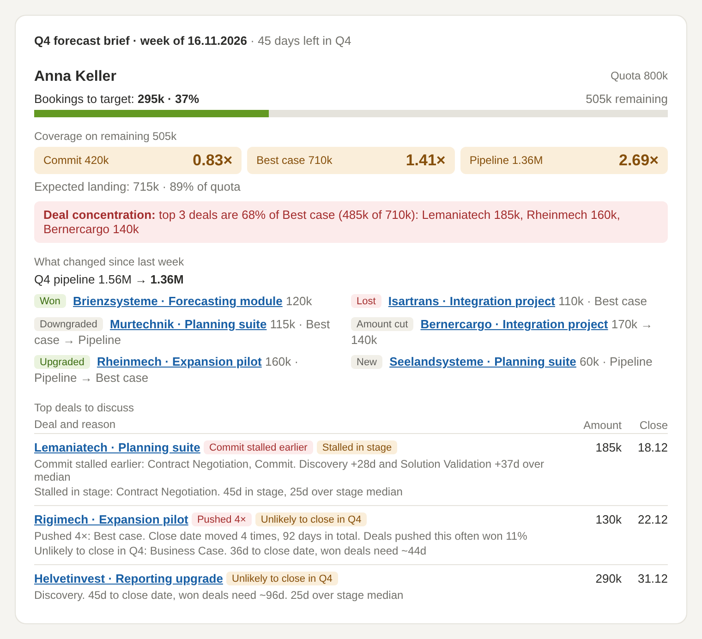
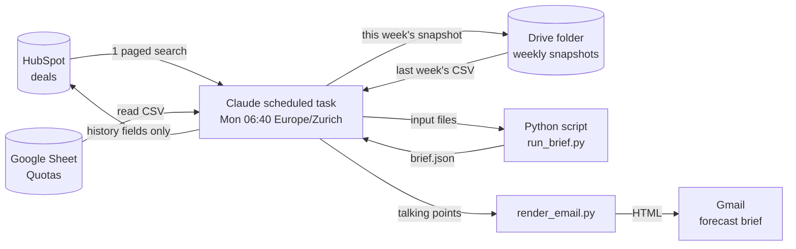

# Weekly Forecast Brief: HubSpot + Claude

An automated **forecast brief for sales managers**. Every Monday morning it reads the pipeline from HubSpot,
compares it with last week, and emails one brief that answers the three questions of every forecast call:
**Will each rep make the number? What changed since last week? Which deals need a conversation, and why?**

Built with **HubSpot Free CRM, Claude (scheduled task + connectors), Google Drive and Gmail**.
All numbers come from a deterministic Python script that is tested against an answer key; Claude handles the
plumbing and writes the talking points. All companies, people and figures are fictional.



*One rep's section of the brief for the week of 16.11.2026. The full email (both reps, talking points, appendix)
is in [`docs/preview/`](docs/preview/).*

---

## Contents

1. [The challenge](#1-the-challenge)
2. [The solution](#2-the-solution)
3. [What the brief shows](#3-what-the-brief-shows)
4. [Data: where it comes from and where it is kept](#4-data-where-it-comes-from-and-where-it-is-kept)
5. [The analytics: formulas](#5-the-analytics-formulas)
6. [Flags and rules](#6-flags-and-rules)
7. [Snapshots and HubSpot write-back](#7-snapshots-and-hubspot-write-back)
8. [Validation](#8-validation)
9. [From demo to a real company setup](#9-from-demo-to-a-real-company-setup)
10. [v1 (n8n) → v2 (Claude)](#10-v1-n8n--v2-claude)
11. [Repository and how to run](#11-repository-and-how-to-run)
12. [Limitations and next steps](#12-limitations-and-next-steps)

---

## 1. The challenge

Before a forecast call, a sales manager needs three answers per rep:

1. **Are we going to make the number?** Not "how big is the pipeline", but: how much is already won, how much
   of the quota is still open, and how well is that remaining gap covered by Commit, Best case and pipeline.
2. **What changed since last week?** A CRM shows today's pipeline, not how it got there. "Q4 pipeline dropped
   from 1.40M to 1.09M" is only useful together with *which* deal was lost, pushed out or cut.
3. **Which deals are at risk, and why?** Deals that stall, keep slipping, have a close date the sales cycle
   cannot reach, or are forecast more optimistically than their stage justifies.

On HubSpot's free plan there are **no forecasting tools, no stage history and no pipeline snapshots**, so
this is usually rebuilt by hand in spreadsheets every week, and every manager does it differently.

A first version of this project (v1, built in n8n) automated the brief. Reviewing it surfaced three problems
that this version fixes:

- **No bookings view.** The demo reps had no deals won in the current quarter, so the brief could not show
  bookings to target or coverage of the *remaining* target, which is the number a manager actually manages to.
- **Inconsistent "time needed to close".** Two deals in the same stage could show different remaining sales-cycle
  times, because the time already spent in the stage was subtracted per deal. Hard to explain in a meeting.
- **Formatting.** Coverage and bookings, the most important numbers, did not stand out.

## 2. The solution



**Design principle: numbers by rules, words by AI.**

| Part | Who does it | Why |
|---|---|---|
| Fetch data from HubSpot, Drive | Claude, via its HubSpot and Google Drive connectors | No API keys or servers to manage in the demo |
| Every number, flag and ranking | `run_brief.py` (Python standard library, no dependencies) | Deterministic, testable, auditable. The same input always gives the same brief |
| Talking points (2–3 per rep) | Claude, from the flags in `brief.json` | Turns flags into questions for the 1:1. Claude may only use numbers already in `brief.json` |
| Email layout | `render_email.py` | Fixed, tested template. Claude passes the HTML through unchanged |
| Send, save snapshot, write back | Claude, via Gmail, Drive and HubSpot connectors | Writes are limited to the snapshot file and the history fields listed in `brief.json` |

The scheduled task's prompt is three lines: clone this repo and follow [`docs/weekly_run.md`](docs/weekly_run.md).
The procedure lives in the repo, so changes go through version control like any code change.

Settings in [`config/settings.json`](config/settings.json):

- `testMode`: the brief gets `[TEST]` in the subject and a banner, and nothing is written to Drive or HubSpot.
- `asOfDate`: replays any week (the demo replays 16.11.2026). Empty = today.
- Stage IDs, forecast categories, coverage thresholds, flag thresholds: all rules are configuration, not code.

## 3. What the brief shows

**Team row:** team quota, won so far, remaining target, days left, team expected landing.

**Per rep:**

| Section | Content |
|---|---|
| Bookings to target | Won this quarter vs quota, progress bar, remaining target |
| Coverage on remaining target | Three tiles (Commit, Best case, Pipeline) as a multiple of what is still open, coloured green/amber/red |
| Expected landing | Won + Commit, as % of quota |
| Deal concentration | Red box when the top 3 deals carry more than 60% of Best case |
| What changed since last week | Pipeline total last week → this week, then every change in two columns: won, lost, pushed out of the quarter, downgraded, upgraded, amount cut or increased, new, pulled in |
| Top deals to discuss | 3 deals, each with flag tags, the reason in words, amount and close date |
| Talking points for the call | 2–3 questions written by Claude from the flags |

**Appendix:** every flagged deal per rep. **Footer:** the colour rules and the stage benchmarks.
Every deal name links to the HubSpot record.

## 4. Data: where it comes from and where it is kept

| Data | Source | Kept where | Maintained by | Updated |
|---|---|---|---|---|
| Deals: stage, amount, close date, forecast category | HubSpot standard properties | HubSpot | Reps | Live |
| Date entered each stage (`moved_to_<stage>`) | Custom date properties (HubSpot Free has no stage history) | HubSpot | Weekly write-back (§7); the demo history came from the data import | Weekly |
| Close-date push count, total days slipped, original close date | Custom properties | HubSpot | Weekly write-back (§7) | Weekly |
| Quotas per rep and quarter | Google Sheet "Quotas" (HubSpot Free has no goals) | Google Drive | Sales manager / Sales Ops. Claude only reads it | Per quarter |
| Weekly snapshot of all open deals | `snapshot_YYYY-MM-DD.csv`, one file per week | Google Drive folder | Created by the weekly run, never edited | Weekly |
| Stage benchmarks (medians) | Calculated from won deals | Not stored: recalculated every run, shown in the email footer and in `brief.json` | Script | Every run |

Close dates are stored in UTC by HubSpot (e.g. `2026-09-30T22:00:00Z`). They are converted to
**Europe/Zurich** before any quarter logic. Without this, a deal closing on 01.10.2026 local time lands in Q3.

**Scope:** only reps listed in the Quotas sheet are reported. Other teams using the same pipeline (here the
partner-channel reps) are excluded from the brief *and* from the benchmarks.

## 5. The analytics: formulas

All amounts are deal amounts in one currency. "Quarter" = the quota row in the Quotas sheet that contains the
as-of date. "Open in quarter" = open deals whose close date (local time) falls inside that quarter.

### Bookings and coverage

| Metric | Formula |
|---|---|
| Won | Sum of deals in Closed Won with close date in the quarter |
| Remaining target | Quota − Won |
| Commit coverage | Σ open-in-quarter deals with category Commit ÷ remaining target |
| Best case coverage | Σ open-in-quarter deals with category Commit **or** Best case ÷ remaining target |
| Pipeline coverage | Σ all open-in-quarter deals ÷ remaining target |
| Expected landing | Won + Commit, and as % of quota |
| Deal concentration | Σ top 3 Best case deals (incl. Commit) by amount ÷ Best case total. Flag if > 60% |

**Coverage colours:** Commit green ≥ 1.0×, amber 0.7–1.0×. Best case green ≥ 1.5×, amber 1.0–1.5×.
Pipeline green ≥ 3.0×, amber 2.0–3.0×. Red below amber. Coverage is measured against the **remaining** target,
because pipeline only has to cover what is not yet won.

### Stage benchmarks: the median sales cycle per stage

These are the benchmarks behind "Stalled in stage" and "Unlikely to close".

- **Data:** every Closed Won deal of the reps in the Quotas sheet, closed on or before the as-of date
  (59 deals in the demo, including this quarter's wins). Lost and open deals are not used: the benchmark
  describes how long deals that **did** close took.
- **Time in stage** for one won deal = date it entered the next stage − date it entered this stage.
  For the last stage (Contract Negotiation) = close date − date it entered Contract Negotiation.
- **Stage median** = the median of those durations across all won deals. The median, not the average,
  so a few very slow deals do not distort it.
- **Won deals need from stage S** = the sum of the stage medians from S to signature.
  This gives **one number per stage**, the same for every deal in that stage (the v1 inconsistency).
- **Updated:** recalculated from scratch on **every run**, so each new win joins the benchmark the next Monday.
  Nothing is stored or maintained by hand.

Benchmarks in the demo (as of 16.11.2026):

| Stage | Median days in stage | Won deals need from entering this stage |
|---|---|---|
| Qualification | 15 | ~111 days |
| Discovery | 21 | ~96 days |
| Solution Validation | 31 | ~75 days |
| Business Case | 24 | ~44 days |
| Contract Negotiation | 20 | ~20 days |

Example: a deal in Discovery with a close date 45 days away is flagged, because won deals took ~96 days from
entering Discovery to signature.

### What changed since last week (waterfall)

Last week's snapshot and today's deals are matched by **HubSpot record ID**. The open in-quarter pipeline moves
from last week's total to this week's total through these buckets, which must add up exactly (checked in code):

`last week + new + pulled into quarter + amount changes − pushed out − lost − won − reassigned = this week`

## 6. Flags and rules

Flags are raised only for **open deals closing in the current quarter**, plus **overdue** open deals (close date
already passed). Next-year pipeline is not flagged. All thresholds are in `config/settings.json`.

| Flag | Rule | Example text in the brief |
|---|---|---|
| **Close date passed** | Open deal, close date before the as-of date | "Qualification. Close date 30.09.2026 has passed" |
| **Commit stalled earlier** / **Best case stalled earlier** | Category Commit or Best case, and at least 2 earlier stages each took more than 1.5× the won-deal median | "Contract Negotiation, Commit. Discovery +28d and Solution Validation +37d over median" |
| **Pushed N×** | Close date pushed 3 or more times | "Best case. Close date moved 4 times, 92 days in total. Deals pushed this often won 11%" |
| **Slipped Nd** | Pushed fewer than 3 times, but more than 60 days slipped in total | "Close date moved 75 days in total" |
| **Unlikely to close in Q4** | Days until the close date are fewer than "won deals need" from the current stage | "Discovery. 45d to close date, won deals need ~96d. 25d over stage median" |
| **Stalled in stage** | Not already "Unlikely to close", and days in the current stage exceed the median by more than 50% | "Contract Negotiation. 45d in stage, 25d over stage median" |
| **Category above stage** | Forecast category higher than the stage justifies. Stage defaults: Qualification and Discovery → Pipeline, Solution Validation and Business Case → Best case, Contract Negotiation → Commit | "Discovery called Best case (stage default: Pipeline)" |

"Xd over stage median" is only shown when the deal is over. The win rates for pushed deals (3 pushes: 44%,
4 or more: 11%) were measured on the closed deals of the demo dataset and are stored as constants in the settings.

**Top deals to discuss (3 per rep).** One deal per flag type, in this priority order: Commit/Best case stalled
earlier → Pushed N× → Category above stage → Unlikely to close. Within a type, the largest amount wins.
Overdue deals are excluded (they are a hygiene topic and stay in the appendix). If fewer than 3 types apply,
the list is filled with the largest remaining flagged deals. The idea: three *different* problems per call,
not the same problem three times.

## 7. Snapshots and HubSpot write-back

**Snapshot.** Each live run saves all open deals of the reported reps (stage, category, amount, close date,
push count, days slipped) as `snapshot_YYYY-MM-DD.csv`. Next week's run compares against it. Files are never
edited, which also gives an audit trail for measuring forecast accuracy later.

**Write-back.** HubSpot Free does not record when a deal changed stage or how often its close date moved.
The weekly run fills these history fields by comparing HubSpot with last week's snapshot. It **only fills gaps
and never overwrites**:

| Detected since last week | Written to HubSpot |
|---|---|
| Stage changed (or new deal), and its "Moved to <stage>" field is empty | That field = run date |
| Close date moved later, and the push count in HubSpot still equals last week's | Push count +1, total days slipped + the days moved, original close date (if empty) |

If a field is already filled (by a person, an import or an earlier run), nothing is written. Re-running the
same week therefore cannot count a push twice. In the demo week this gives 0 updates, because the data import
already recorded that week's changes.

## 8. Validation

- **Answer key.** The demo data was generated with known scenarios built in (a won and a lost deal, a deal pushed
  out of the quarter, downgrades and an upgrade, amount cuts, a new deal, chronic pushers, a Commit deal that was
  slow in earlier stages). [`tests/expected/answer_key_16.11.2026.md`](tests/expected/answer_key_16.11.2026.md)
  lists every number, change and flag the brief must show for 16.11.2026.
- **Automated tests (24, `python3 -m unittest discover -s tests`):**
  - the full run on a frozen HubSpot export reproduces the answer key line by line, all 20 flagged deals included
  - time zone and quarter boundaries, rep scope, next-year exclusion, waterfall balance, write-back idempotency
  - email: no CSS backgrounds (see below), no layout Gmail drops, every deal linked, names escaped
- **In every test-mode run** the brief compares itself with the answer key and shows "Answer key check: PASS"
  in the TEST banner.
- **Live:** test-mode run on 14.11.2026 checked in Gmail on desktop and mobile; first scheduled live run on
  Monday 16.11.2026.

**Lesson learned:** the Gmail connector strips every CSS `background` style at send time, so the coloured tiles
arrived white. Found by inspecting the sent message; fixed by using the HTML `bgcolor` attribute for all fills.
The tests now fail if a CSS background appears in the template.

## 9. From demo to a real company setup

The demo is deliberately built the way a real automation would be: rules in configuration, numbers in tested
code, a test mode, version control, and an audit trail. Moving it into a company is mostly a matter of
replacing the free-plan workarounds:

| Part | Demo (free tools) | In a company |
|---|---|---|
| Stage dates | Custom `moved_to_<stage>` fields, stamped weekly by the write-back (accurate to the week) | Sales Hub Professional or Enterprise records "Date entered [stage]" automatically (`hs_v2_date_entered_<stage id>`), including history. Change `movedProperty` in the settings; the stage-date write-back is no longer needed |
| Push count and days slipped | Weekly comparison with the snapshot | Same logic, or a HubSpot workflow (paid tiers) that counts on every close-date change |
| Quotas | Google Sheet maintained by the manager | Owned by Sales Ops or Finance, in the company's planning sheet or tool. The script only needs rep, quarter start/end and quota |
| Scheduling | Claude scheduled task with connectors | Either the same, or the Python script in any scheduler (cron, GitHub Actions, cloud function) with a HubSpot private app token: read access to deals, write access only to the history fields |
| Snapshots | CSV files in Google Drive | A table in the data warehouse, which also enables forecast-accuracy reporting |
| Email | Dedicated Gmail account to one inbox | A transactional email service (e.g. Resend) on the company domain; each manager receives their own reps, mapped in the quota sheet |
| Benchmarks | All won deals of the team | At least ~12 months of won deals; separate medians per segment or product if sales cycles differ |
| Changes | Commit to the repo, run in test mode | Same, with the tests run automatically on every change (CI) |

Points to agree with the company before go-live: which reps and pipelines are in scope, the thresholds (they
are a sales-leadership decision, not a technical one), who owns the quota sheet, and whether deal data may be
processed by an AI service under the company's data policy. Without the talking points, the brief is fully
rule-based and needs no AI at run time.

## 10. v1 (n8n) → v2 (Claude)

| | v1: n8n | v2: Claude |
|---|---|---|
| Orchestration | n8n Cloud workflow (HubSpot, Google Sheets, Gmail nodes) | Claude scheduled task with connectors, procedure in the repo |
| Analysis | JavaScript Code node | Python script, standard library, 24 tests |
| Bookings to target, coverage of remaining target | Not possible (no wins in the quarter) | Yes, with expected landing |
| Time needed to close | Different per deal in the same stage | One benchmark per stage, the same for every deal |
| Deal matching across weeks | By deal name | By HubSpot record ID |
| Stage dates and push counts | Filled by the data import only | Maintained by the weekly write-back |
| Snapshots | Appended to a Google Sheet tab | One CSV file per week (Sheets are read-only for the connector) |
| Concentration | Single-deal share of quota | Top 3 share of Best case |
| Talking points | None | 2–3 per rep, written by Claude from the flags |
| Validation | Answer key, checked manually | Answer key as an automated test, plus a check in every test-mode run |

## 11. Repository and how to run

| Path | Contents |
|---|---|
| [`run_brief.py`](run_brief.py) | Analysis: inputs → `brief.json` and this week's snapshot |
| [`render_email.py`](render_email.py) | `brief.json` + talking points → HTML email (or `--slide "<rep>"` for the slide image) |
| [`check_answer_key.py`](check_answer_key.py) | Compares a run with the answer key |
| [`config/settings.json`](config/settings.json) | Test mode, as-of date, stage IDs, all thresholds |
| [`src/forecast_brief/`](src/forecast_brief/) | `load` (inputs, time zone), `flags` (benchmarks, flags, top 3), `changes` (week-over-week, waterfall), `writeback`, `brief`, `email_html` |
| [`docs/weekly_run.md`](docs/weekly_run.md) | The procedure the scheduled task follows |
| [`docs/output.md`](docs/output.md) | Fields in `brief.json` |
| [`tests/`](tests/) | Frozen demo inputs, answer key, tests |
| [`assets/`](assets/), [`docs/preview/`](docs/preview/) | Slide image, full email preview |

```
python3 run_brief.py --deals tests/fixtures/deals_16.11.2026.json \
  --quotas tests/fixtures/quotas.csv --snapshot tests/fixtures/snapshot_2026-11-09.csv \
  --as-of 16.11.2026 --test-mode --out brief.json --markdown key.md
python3 check_answer_key.py --markdown key.md
python3 render_email.py --brief brief.json \
  --talking-points tests/fixtures/talking_points_16.11.2026.json --html email.html
python3 -m unittest discover -s tests
```

Requires Python 3.9+ and nothing else.

## 12. Limitations and next steps

**Limitations**
- Synthetic data: 2 reps, 354 deals, one pipeline, one currency.
- Stage dates written by the weekly run are accurate to the week, not the day (exact in paid HubSpot tiers).
- The pushed-deal win rates are fixed values from the demo dataset, not recalculated each run.
- The demo replays 16.11.2026; after the live run the schedule is paused and the brief is started on demand.

**Next steps**
- Forecast accuracy: compare each week's Commit with what actually closed, per rep, from the snapshots.
- Recalculate the pushed-deal win rates from closed deals on every run, like the stage benchmarks.
- Per-rep benchmarks as a coaching view ("Marco's deals take 30% longer in Business Case").
- Instant alert when a large Commit deal is pushed or lost.

## How it was built

I designed the process, the metrics and rules, the HubSpot data model and the email, defined the test scenarios
and validated the output against the answer key. I used Claude (Anthropic's AI assistant) to generate the synthetic
dataset, write and test the Python code under my direction, and run the weekly task.
